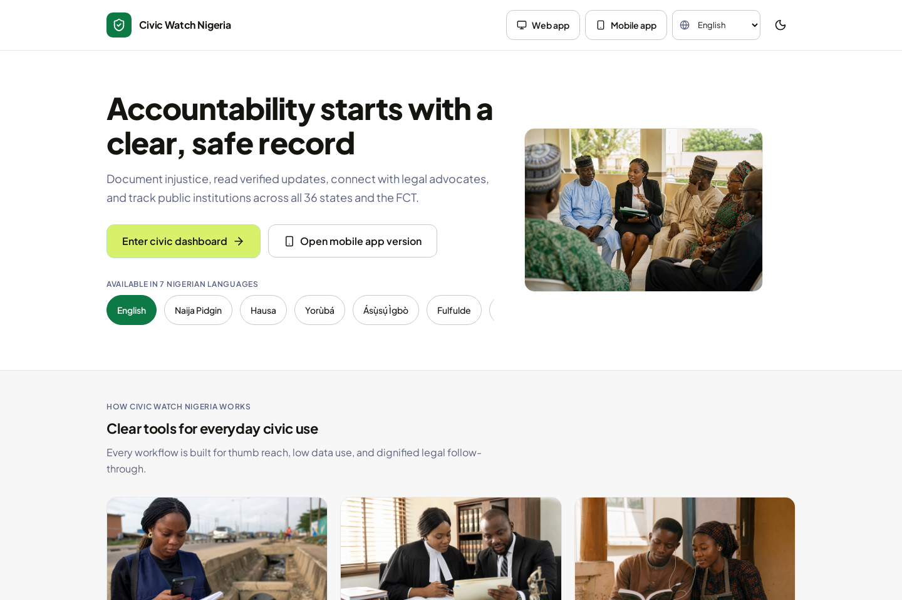
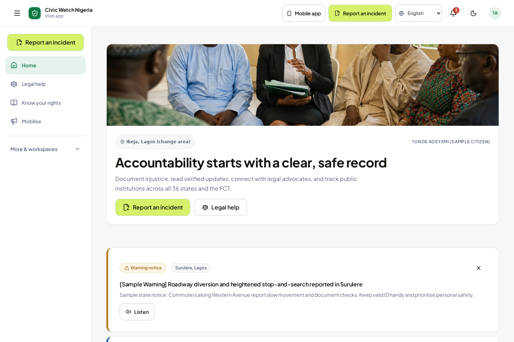
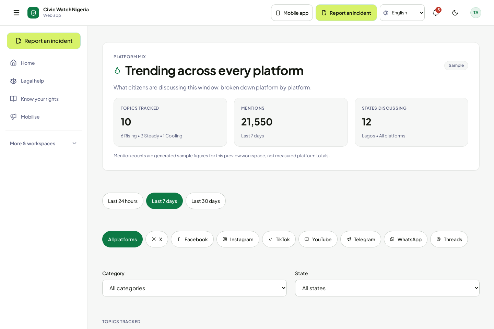
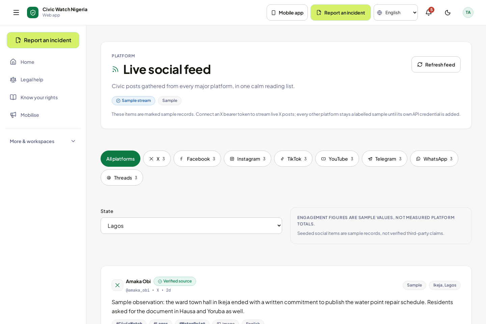
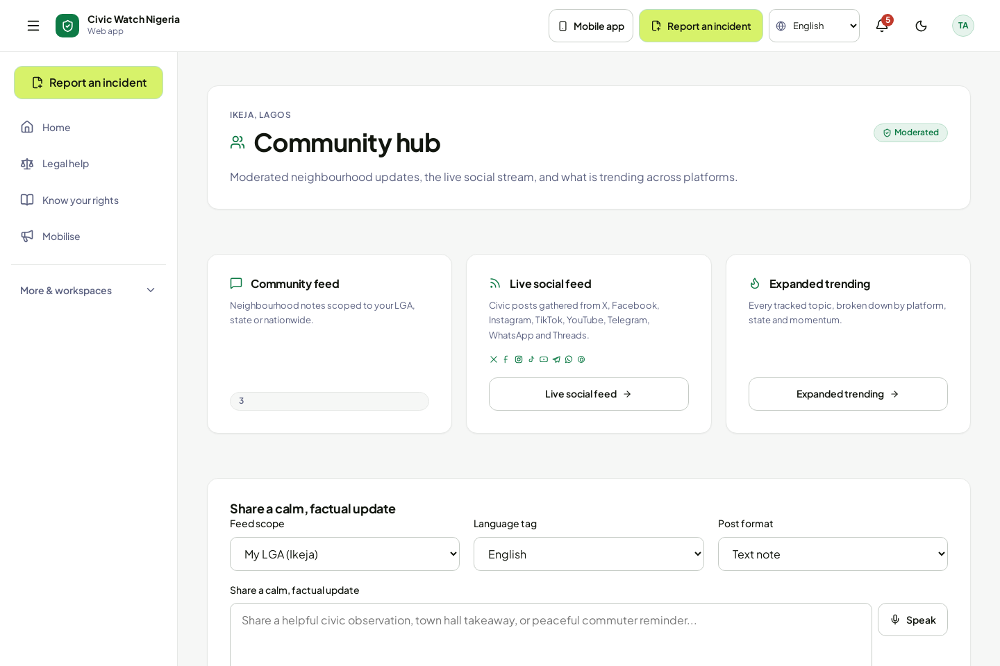
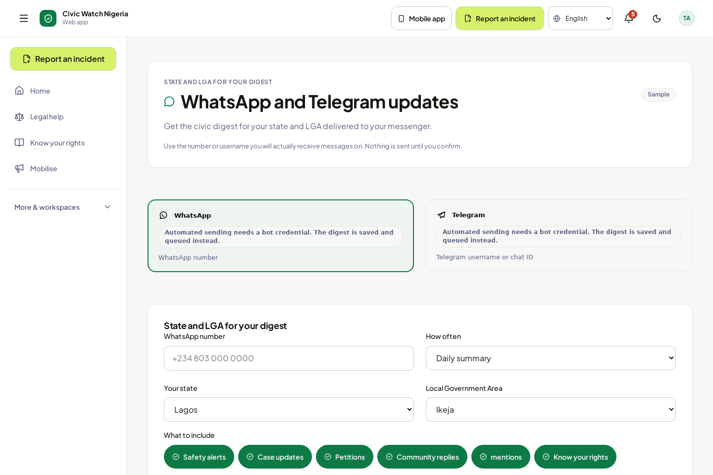
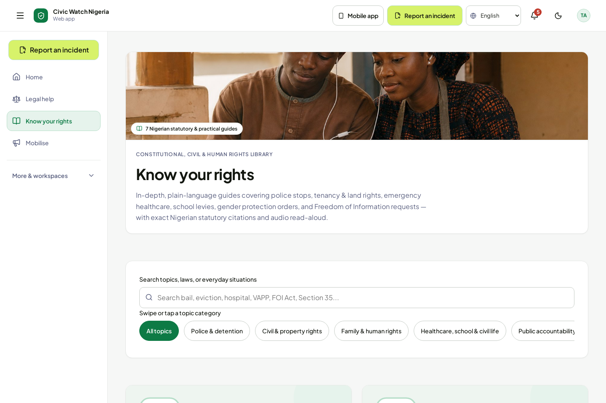
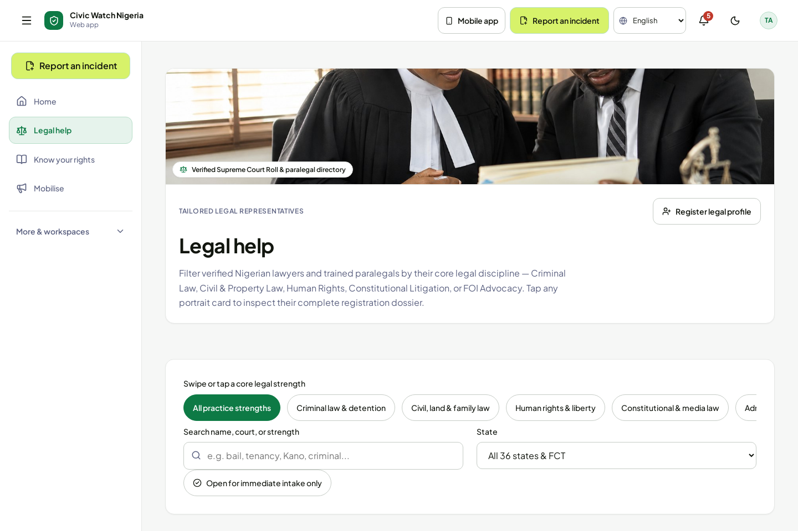
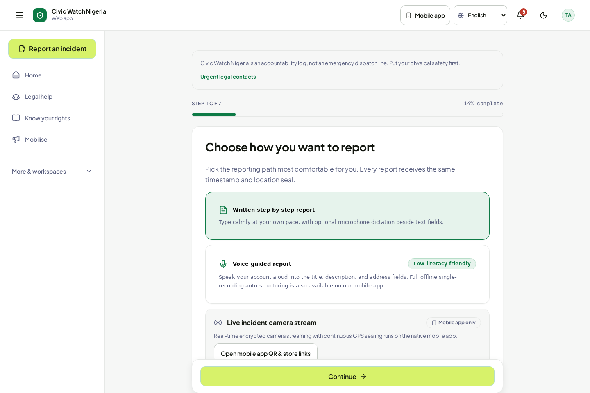
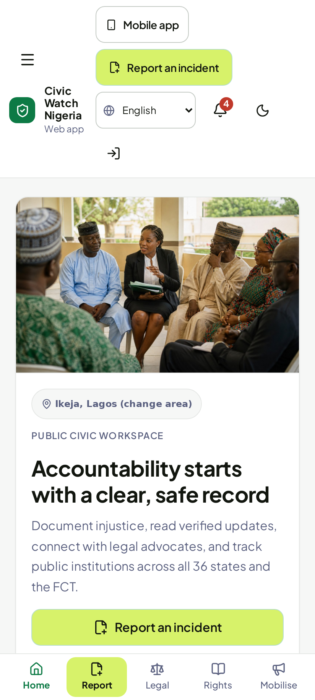

# Civic Watch Nigeria

A civic accountability application: document an incident, follow the sealed record, read
plain-language rights guides, reach a verified legal advocate, mobilise peacefully, and
track what citizens are discussing across social platforms.

Two complete editions in one codebase:

| Edition | How it runs | Data storage |
| --- | --- | --- |
| **Node edition** (default) | Express server + SQLite on port 4000 | `data/civic_watch.sqlite` on disk |
| **Static edition** (`CWN_PLATFORM=netlify`) | Everything in the browser, no server | SQLite (sql.js) persisted to IndexedDB |

Both run the same route handlers (`server/app.ts`) and the same schema (`server/db.ts`),
so behaviour is identical.



## Quick start

```bash
npm install          # install dependencies
npm run build        # build the client bundle into dist/
npm run server       # start the API + app on http://localhost:4000
```

Open <http://localhost:4000>. For development with hot reload:

```bash
npm run dev          # Vite on :5173 proxying /api to :4000
```

### Sample accounts

All records are seeded demonstration data and marked `Sample` in the interface.

| Role | Email | Password | Notes |
| --- | --- | --- | --- |
| Citizen | `citizen@civicwatch.sample.ng` | `CivicCitizen2026!` | MFA off |
| Advocate | `advocate@civicwatch.sample.ng` | `CivicAdvocate2026!` | MFA on |
| Admin | `admin@civicwatch.sample.ng` | `CivicAdmin2026!` | MFA on |

For the two MFA accounts the authenticator code is `246810` in this demo build.

## Screenshots

| | |
| --- | --- |
|  |  |
|  |  |
|  |  |
|  |  |

Mobile edition at 412px:



## Features

**Reports and cases.** A seven-step reporting flow with consent, privacy choice
(anonymous or attributable, public or private), state and LGA declaration, private
evidence upload with a SHA-256 seal, and a generated case reference
(`CWN-YEAR-STATE-#####`). Case pages track stage changes and case notes.

**Justice directory.** Verified advocate profiles built from fields captured at
registration — specialisations such as civil, criminal and human-rights law, languages,
Bar number, availability hours — plus consultation requests.

**Mobilise.** Petitions with signature tracking, campaigns, town halls with RSVPs, and
volunteer roles with applications.

**Community hub.** Scoped feed (national / state / LGA), reaction counts, replies,
flagging to moderation, seven languages, and voice input.

**Live social feed.** Posts gathered across X, Facebook, Instagram, TikTok, YouTube,
Telegram, WhatsApp and Threads, filterable by platform and state, with verification
badges and links to the original post. Uses the X API when `X_BEARER_TOKEN` is set;
otherwise the posts are clearly labelled sample records.

**Expanded trending.** 24-hour, 7-day and 30-day windows, momentum per topic,
platform-mix bars, a topic-by-platform matrix, sparkline series and top voices.

**Messenger updates.** WhatsApp and Telegram digests built from records scoped to the
state and LGA given at registration, with topic choice, frequency, consent, preview,
pause/resume and delete. Includes a Telegram webhook handling `/start`, `/state` and
`/stop`.

**Push notifications.** Real Web Push with VAPID keys, a service worker, topic and
area scoping, a test send, and a delivery log. When a device cannot receive push, alerts
fall back to the in-app notification log and the interface says so.

**Civic information.** Seven guides in the Knowledge Centre, plain-language
constitutional information, and a civic assistant that routes legal questions to a
human advocate rather than answering them itself.

**Accessibility and language.** Seven languages (English, Naija Pidgin, Hausa, Yorùbá,
Asụsụ Igbo, Fulfulde, Kanuri) with full interface translation, WCAG 2.2 AA targets,
48×48 controls, speech synthesis and recognition, light and dark themes, and a separate
412px mobile edition.


## Database

`data/civic_watch.sqlite` ships with the repository so the application is immediately
usable. It is a real SQLite database — open it with any SQLite client.

28 tables, all wired to routes:

```
users                 advocates             reports              case_notes
consultations         petitions             signatures           campaigns
campaign_members      town_halls            town_hall_rsvps      volunteer_roles
volunteer_applications posts                post_replies         broadcast_alerts
notifications         knowledge_guides      whatsapp_subscriptions civic_activities
donations             platform_settings     push_subscriptions   push_delivery_log
social_posts          trending_topics       bot_subscriptions    bot_digests
```

Useful queries:

```sql
-- who is in the demo
SELECT email, full_name, role, state, lga FROM users;

-- every case with its stage
SELECT case_reference, title, status, state, lga FROM reports ORDER BY created_at DESC;

-- community activity
SELECT author_name, content, solidarity_count, reply_count FROM posts;

-- platform mix for a trending topic
SELECT hashtag, platform_mix FROM trending_topics;

-- what the messenger bot has queued
SELECT channel, handle, state, lga, topics, frequency, status FROM bot_subscriptions;
SELECT headline, item_count, status, created_at FROM bot_digests;
```

The database is created and seeded automatically on first boot if the file is absent.
To start from a clean seed, delete `data/civic_watch.sqlite` and restart the server.
WAL sidecar files (`-wal`, `-shm`) are runtime state and are not published.

## Configuration

Every integration is optional. Absent credentials produce an honest "not configured"
state rather than simulated success.

| Variable | Purpose |
| --- | --- |
| `PORT` | Server port (default `4000`) |
| `JWT_SECRET` | Token signing secret. Set this in any real deployment |
| `X_BEARER_TOKEN` | Enables live X/Twitter search for the social feed |
| `TELEGRAM_BOT_TOKEN` | Enables actual Telegram digest delivery |
| `TELEGRAM_BOT_USERNAME` | Bot handle used for the deep link |
| `TELEGRAM_WEBHOOK_SECRET` | Validates incoming webhook calls |
| `WHATSAPP_TOKEN` | WhatsApp Cloud API token |
| `WHATSAPP_PHONE_ID` | WhatsApp sender phone number ID |
| `WHATSAPP_BUSINESS_NUMBER` | Displayed contact number |
| `WHATSAPP_CHANNEL_URL` | Channel link shown in the interface |

VAPID keys for Web Push are generated once on first run and stored in
`platform_settings`.

## Static (Netlify) edition

```bash
node scripts/build-netlify.mjs      # builds netlify-drop/
node scripts/pack-netlify.mjs       # zips it into civic-watch-nigeria-netlify.zip
node scripts/verify-netlify-bundle.mjs   # 25-check headless walkthrough
```

The output folder is self-contained and can be dragged onto
<https://app.netlify.com/drop>. The Express handlers and SQLite schema are bundled into
the page: `better-sqlite3` is replaced by sql.js persisted to IndexedDB, so every flow
completes and survives a reload with no server. See [NETLIFY-DEPLOY.md](NETLIFY-DEPLOY.md)
for what does and does not carry over (per-browser data, no lock-screen push).

## Project layout

```
server/
  index.ts          Node entry: opens SQLite, mounts dist/, listens on :4000
  app.ts            All API routes (shared by both editions)
  db.ts             Schema, seeding and the swappable database connection
  integrations.ts   Push, social listening, trending, messenger bot
  token.ts          JWT helpers
src/
  pages/            Screens, one per route
  components/       Shared UI, graphics and platform glyphs
  context/          App context: session, language, theme, edition, API helper
  data/i18n/        Seven typed dictionaries (317 keys, parity enforced)
  platform/         Browser runtime: compat shims and the IndexedDB SQLite facade
  styles/           Design tokens and shared classes
scripts/            Build, packaging, type/i18n checks and end-to-end verification
data/               SQLite database and private evidence directory
public/             Images, icons, service worker
docs/screenshots/   Screenshots used above
```

## Checks

```bash
npm run build                            # type-check and build the client
npx tsc -p tsconfig.node.json --noEmit   # type-check the server
npm run check:i18n                       # dictionary key parity across 7 languages
node scripts/verify-netlify-bundle.mjs   # static build end-to-end (needs Playwright)
```

## Design and content rules

The interface follows a fixed set of rules, enforced throughout:

- No emojis, no invented statistics presented as fact, no lorem ipsum, no dark patterns,
  no forced sign-up, no urgency counters.
- Sample data always carries a visible `Sample` label; generated figures are described
  as generated.
- One typeface family (Plus Jakarta Sans), with JetBrains Mono for references and
  figures. Colour is never the only signal.
- Design tokens for every colour, space and type size; no hardcoded hex values.
- Minimum 20px screen padding, 48×48 tap targets, 1100px maximum content width.
- Plain, informational copy. No promotional or marketing language.

## Licence and status

This is a demonstration build. It is not affiliated with any government body, political
party or campaign, and the legal information it presents is general civic information,
not legal advice. Sample accounts, advocates and records are fictional and labelled as
such.
